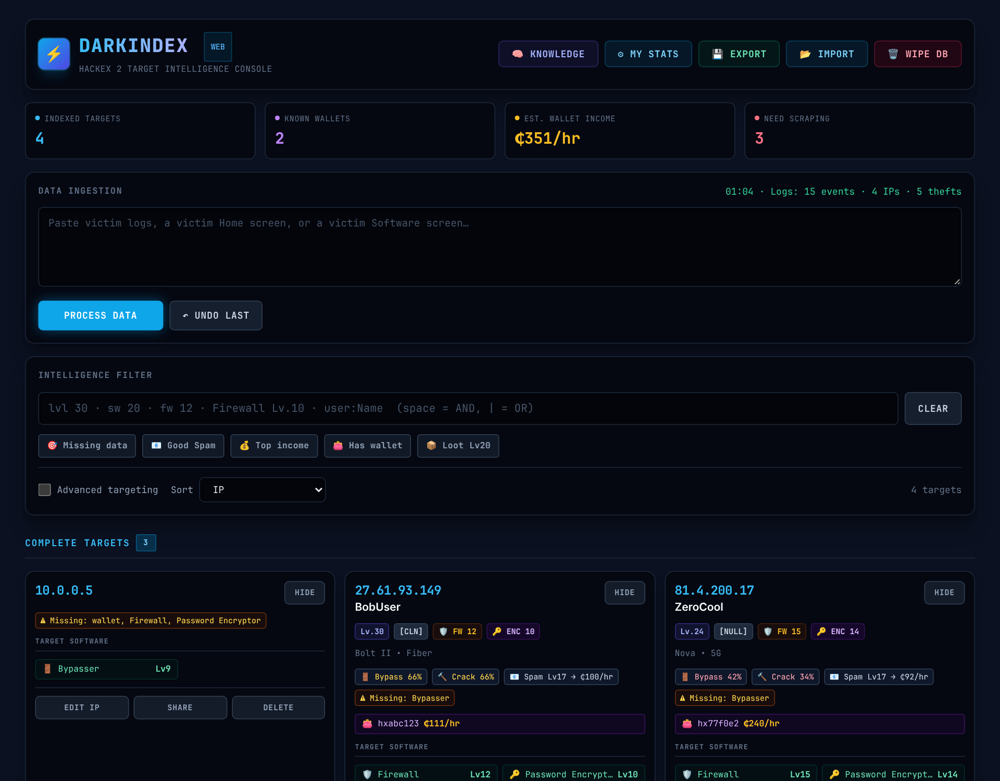
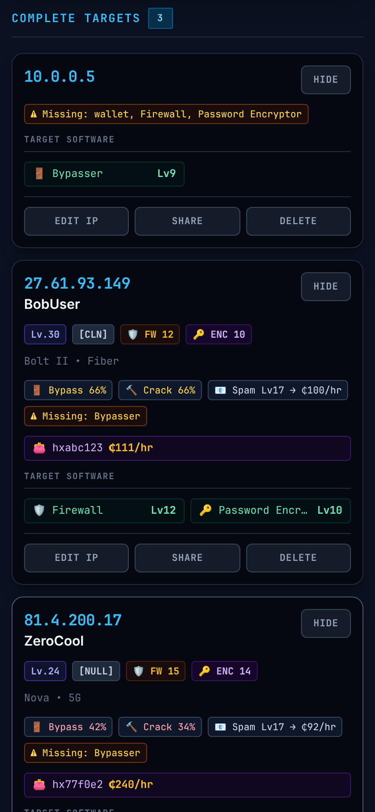
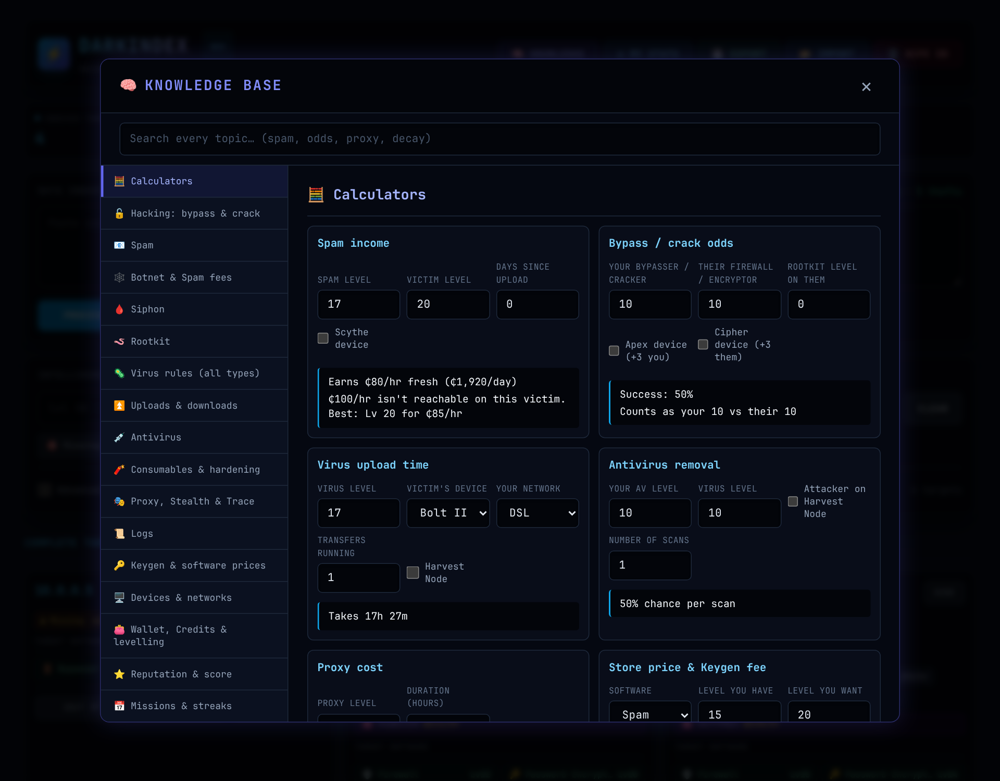

# hackex2_logs

Vibecoded to absolute hell, and somehow it works.

**hackex2_logs** is the web version of [DarkIndex](https://github.com/whisk420/DarkIndex): a target-intelligence console for the mobile game **HackEx 2**. Paste text from the game and it builds a searchable database of every player you've touched: IPs, usernames, clans, software levels, wallets and how much they're worth to you. Then it tells you who to hit, what to upload and what your odds are.

No install, no account, no server. It's one web page that runs in your browser.



---

## Features

- **Paste-and-go parser**: Drop in logs, a victim's Home screen or their Software screen and press **Process data**. The console works out which one you pasted.
- **Local database**: Every target is saved in your browser and merged automatically. Records that share a username or wallet are recognised as the same player.
- **Target cards**: IP (tap to copy), username, clan, level, device, network, Firewall, Encryptor, wallets and every app level you've seen. Masked `xxx` IPs get their own section.
- **Hack odds**: Each card shows your bypass and crack success chance against that target, based on your levels from **⚙ My Stats**.
- **Good Spam**: Shows the cheapest Spam level that still pays the full ₵100/hr on each target, and ranks targets by Spam income.
- **Wallet income estimator**: Groups the steals in your pasted logs into sessions (a gap over an hour starts a new one) and works out each wallet's ₵/hr.
- **Advanced targeting**: One tap filters down to real targets still missing a wallet, Bypasser, Firewall or Password Encryptor, so you know what to scrape next.
- **Search & shortcuts**: `lvl 30`, `sw 20`, `fw 12`, `user:Name` and more (cheat sheet below).
- **Knowledge base**: A plain-language HackEx 2 guide with 19 topics and 8 calculators. Every fact is labelled with where it comes from.
- **Stats bar**: Targets indexed, wallets known, total estimated wallet income and how many targets still need scraping.
- **Undo, export & import**: Undo your last paste, export the whole database as a JSON file, and import it on another device. Imports merge with what's already there.
- **Phone friendly**: Built for the phone you're already playing on.

<p align="center"></p>

---

## Getting started

### Use it

1. Download or clone this repo:
   ```bash
   git clone https://github.com/whisk420/hackex2_logs.git
   ```
2. Open `index.html` in any modern browser. That's it.

### Host it yourself

It's a static site, so any static host works as-is. To host it free on **GitHub Pages**: on GitHub go to **Settings → Pages**, set the source to the `main` branch root, and save. Your copy will be live at `https://<your-username>.github.io/hackex2_logs/` a minute later.

---

## How it works

1. **Set your stats**: Tap **⚙ My Stats** and enter your Bypasser, Password Cracker and Spam levels. Odds and Good Spam use these.
2. **Copy from the game**: Long-press and copy text from HackEx 2:
   - a **log** (yours or a victim's): IPs, steals, wallets and transfers
   - a victim's **Home screen**: IP, username, clan, level, device, network, Firewall and Encryptor
   - a victim's **Software screen**: their app levels
3. **Paste and process**: Paste into the console and press **Process data**. The status line says what was found, and **Undo last** reverses it if something looks wrong.
4. **Hunt**: Search, sort by Good Spam or income, or tap **🎯 Missing data** to see who still needs scraping.

> Logs only keep the last 100 lines in-game, so paste them often or older steals fall off the end.

---

## Search cheat sheet

| Type this | To find |
| :--- | :--- |
| `lvl 30` · `lvl 28-32` | Players at level 30, or between 28 and 32 |
| `sw 20` | Targets with any stealable app at exactly Lv 20 (good for downloading) |
| `fw 12` · `enc 10` · `bp 9` · `pc 9` · `av 8` · `rk 5` | One app around that level (±2) |
| `Spam 17` · `Firewall Lv.12` | One app at exactly that level |
| `user:Bob` · `clan:CLN` · `wallet:hx12` · `hw:Nova` | Match one field |
| `27.61.93.149` · `27.61` | IP, full or partial |
| `fw 12 lvl 30` | Both (space = AND) |
| `Spam 17 \| Siphon 15` | Either (`\|` = OR) |

Anything else matches username, clan, wallet, hardware, IP or app name.

---

## Knowledge base

Tap **🧠 Knowledge** for a HackEx 2 reference, built from DarkIndex's in-app guide and written so you don't need to do any maths. It covers Spam, Siphon, Rootkit, hacking odds, Proxy and Stealth, Antivirus, consumables, logs, Keygen and prices, devices, wallet and Credits, reputation, missions, crews and reboot loadouts. Eight calculators cover Spam income, hack odds, upload time, Antivirus, Proxy cost, store price and Keygen fee, Siphon cut and leaderboard score.

Every entry carries a label so you know how far to trust it:

| Label | Means |
| :--- | :--- |
| **Measured** | Measured in-game by the DarkIndex developer |
| **Confirmed** | Confirmed in-game |
| **Calculated** | From a formula that reproduces the measured or guide numbers |
| **Guide** | From the official hackex.net guide, not yet checked in-game |
| **This app** | How this website itself behaves |



---

## Privacy & storage

Your data never leaves your device.

- **No network calls**: The page doesn't load or send anything online. No analytics, no CDN, no server.
- **Stored in your browser**: The database lives in your browser's local storage (IndexedDB) for this page, on this device only.
- **Back it up**: Clearing your browser's site data, or using a private window, wipes it. Use **💾 Export** now and then, and **📂 Import** to restore or move to another device.

---

## Project layout

```text
hackex2_logs
 ├── index.html         # The page: header, stats bar, ingestion, filter, target grid, knowledge base modal
 ├── app.js             # Parsers, IndexedDB database, merging, search, target cards, export/import
 ├── estimator.js       # Game maths: hack odds, Spam income & decay, upload times, wallet income, hardware
 ├── kb.js              # Knowledge base topics, source labels and calculators
 ├── style.css          # Compiled Tailwind CSS (generated, but committed so no build is needed)
 ├── src/tailwind.css   # Tailwind source: theme components (buttons, cards, panels, knowledge base)
 ├── tailwind.config.js # Tailwind theme: the cyber colour palette, fonts and animations
 └── docs/              # README screenshots
```

---

## Changing styles

`style.css` is compiled from `src/tailwind.css`. If you add or change Tailwind classes in `index.html`, `app.js` or `kb.js`, rebuild it (needs [Node.js](https://nodejs.org)):

```bash
npm install
```

```bash
npm run build:css
```

Use `npm run watch:css` to rebuild automatically while you edit.

---

## Related

- **[DarkIndex](https://github.com/whisk420/DarkIndex)**: The original Android app. It reads the game screen directly with a floating capture button, and adds Siphon alerts, Marathon Mode and auto-backups. The formulas and knowledge base here come from it.

---

## License

Public domain: see [UNLICENSE](UNLICENSE). Do whatever you want with it.
